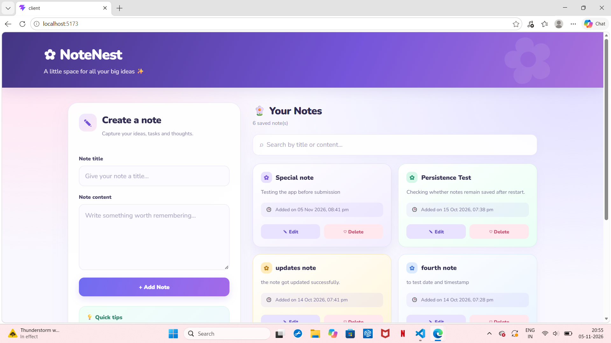
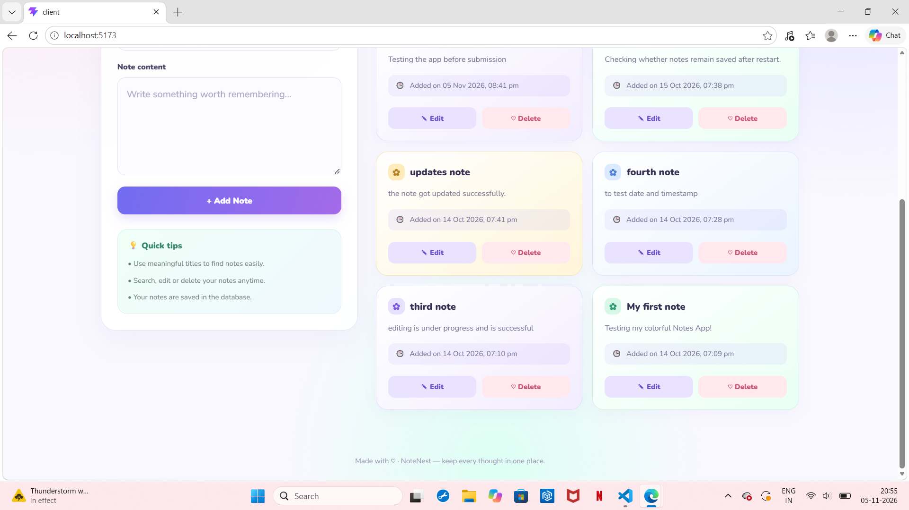
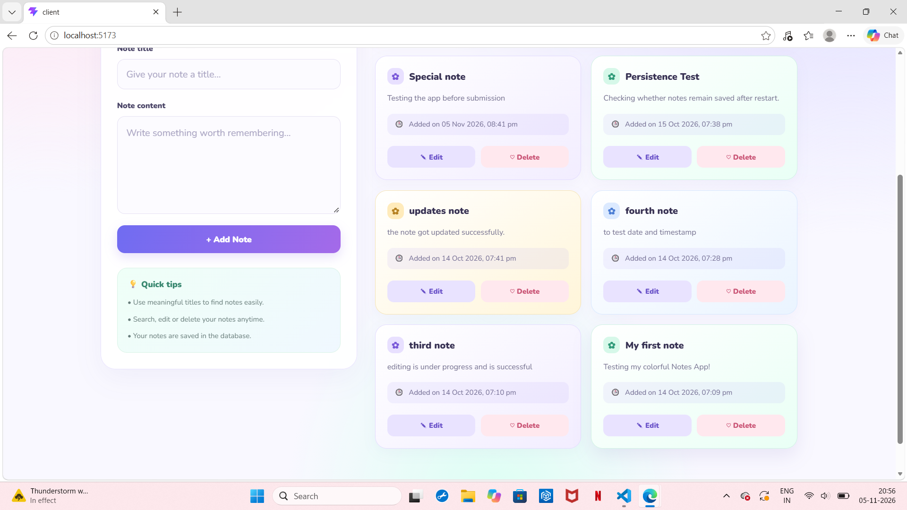
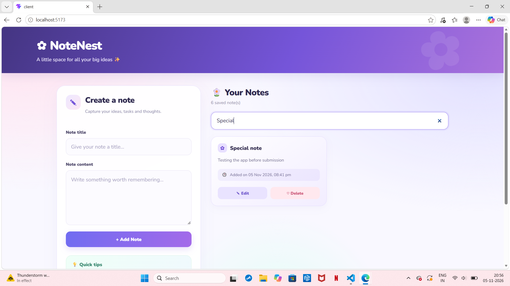
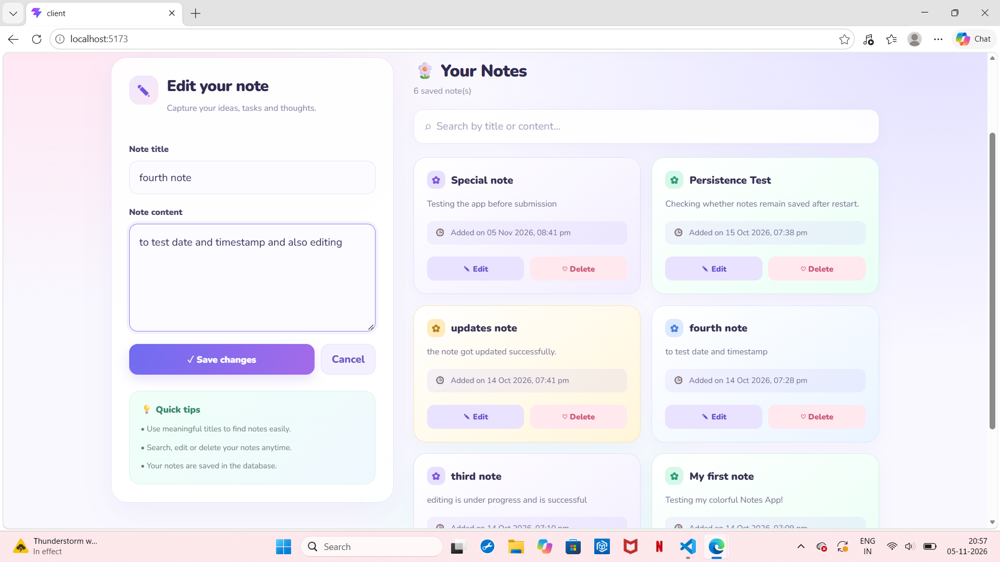
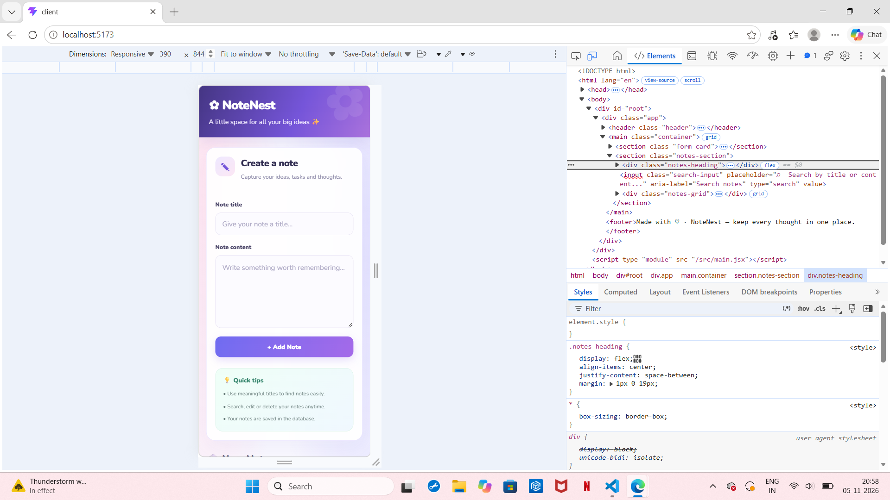
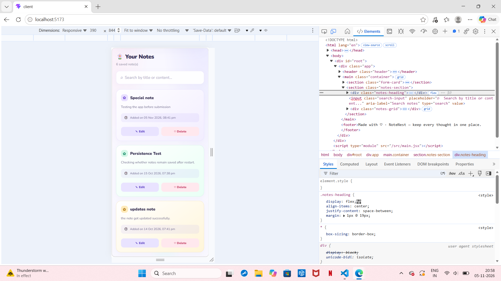
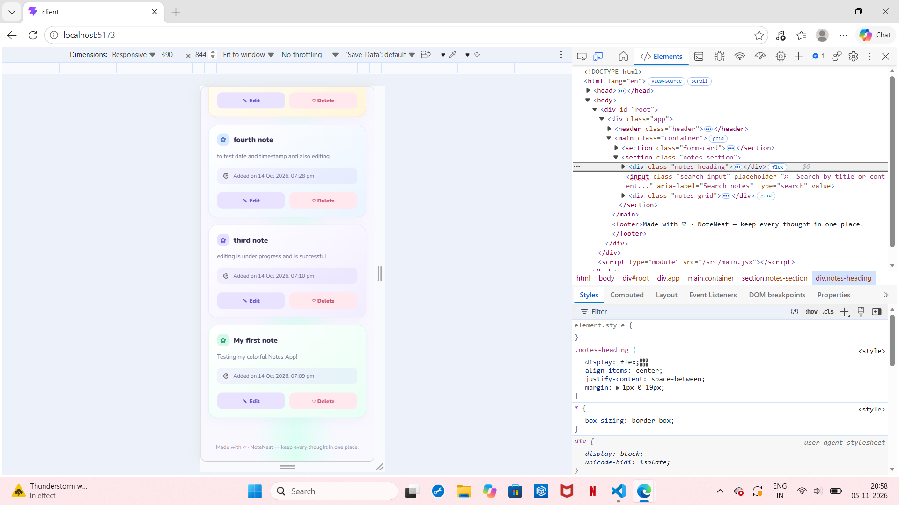
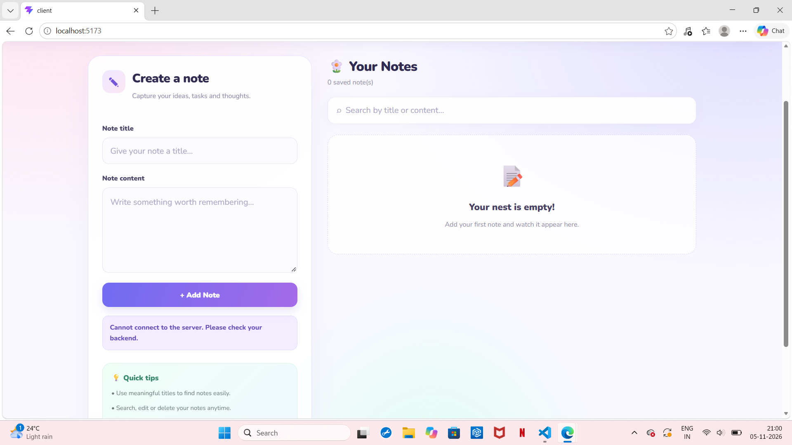

# ✿ NoteNest — Full Stack Notes Application

*A simple, colorful, and responsive space to capture, organize, and revisit your ideas.*

##  Project Overview

**NoteNest** is a full stack Notes Application developed as part of the CodeNova Full Stack Development Program — Batch 01.

The application allows users to create, view, edit, search, and delete notes through a clean and user-friendly interface. It combines a React-based frontend with a Node.js and Express backend, while SQLite provides persistent storage for notes.

Each note includes a title, content, and creation timestamp, helping users keep track of when their ideas were recorded.

The project demonstrates the implementation of CRUD operations, REST API integration, database connectivity, responsive UI design, and error handling in a full stack web application.

##  Project Objectives

The main objectives of NoteNest are to:

- Develop a functional full stack web application.
- Implement Create, Read, Update, and Delete (CRUD) operations.
- Build and consume REST API endpoints.
- Store notes persistently in a relational database.
- Provide search functionality for finding notes quickly.
- Display the date and time when each note was created.
- Design a responsive and visually appealing user interface.
- Handle common errors and provide useful feedback to users.
- Organize the frontend and backend into separate project directories.

##  Features

### 1. Create Notes

Users can create notes by entering a title and content. The application validates the fields before submitting the note to the backend.

### 2. View Saved Notes

All saved notes are displayed as individual cards in the notes section. Each card presents the note title, content, creation timestamp, and available actions.

### 3. Edit Notes

Users can select the Edit option on a note card. The selected note's existing title and content are loaded into the form, allowing the user to make changes and save them.

### 4. Delete Notes

Users can delete notes that are no longer required. A confirmation prompt helps prevent accidental deletion.

### 5. Search Notes

The search bar allows users to find notes by title or content. The displayed notes are filtered as the user types.

### 6. Creation Date and Time

Each note displays the date and time it was created. The timestamp is stored in the database and remains associated with the note when the application is refreshed or the backend is restarted.

### 7. Persistent Database Storage

Notes are stored in an SQLite database rather than being kept only in temporary frontend state. This allows saved notes to remain available after the backend is restarted, provided the application reconnects to the same database file.

### 8. Responsive User Interface

The interface uses a responsive card-based layout and adapts to different screen sizes. Mobile-device preview testing is used to check that the form, search bar, note cards, and action buttons fit smaller screens.

### 9. Error Handling

The application provides user-friendly feedback for common situations, including:

- Backend connection failures.
- Empty title or content fields.
- Failed note creation or updates.
- Failed note deletion.
- Searches that return no matching notes.
- Loading notes from the backend.

##  Technologies Used

| Technology ==> Purpose |
|--- ==> ---|
| React ==> Builds the interactive frontend user interface. |
| Vite ==> Provides the frontend development server and build tooling. |
| JavaScript ==> Implements application logic and interactions. |
| HTML and CSS ==> Structure and style the user interface. |
| Node.js ==> Runs the backend JavaScript environment. |
| Express.js ==> Defines the backend routes and REST API. |
| SQLite ==> Stores notes in a persistent relational database. |
| Fetch API ==> Sends HTTP requests from the frontend to the backend. |
| Git and GitHub ==> Support source-code version control and project sharing. |

##  System Architecture

NoteNest follows a client-server architecture.

1. **Frontend:** The user interacts with the React interface to create, search, edit, view, and delete notes.
2. **API communication:** The frontend sends HTTP requests to the Express backend using the Fetch API.
3. **Backend processing:** The server receives requests, validates input, executes the required operation, and prepares a response.
4. **Database operations:** The backend reads or modifies records in the SQLite database.
5. **Response and display:** The frontend updates the interface using the data returned by the backend.

### Application flow


User
  |
  v
React Frontend
  |
  | HTTP requests
  v
Express REST API
  |
  | Database queries
  v
SQLite Database
  |
  | Query results
  v
Express REST API
  |
  | JSON response
  v
React Frontend


##  Project Structure

The project is organized into separate frontend and backend directories.


codenova-notes/
│
├── client/
│   ├── public/
│   ├── src/
│   │   ├── App.jsx
│   │   ├── App.css
│   │   ├── index.css
│   │   └── main.jsx
│   ├── package.json
│   └── package-lock.json
│
├── server/
│   ├── server.js
│   ├── schema.sql
│   ├── notes.db
│   ├── package.json
│   └── package-lock.json
│
├── README.md
└── .gitignore


### Important files

- **`client/src/App.jsx`** — Contains the main React component, form handling, API requests, search filtering, and note-card rendering.
- **`client/src/App.css`** — Defines the main application styling, note cards, form layout, colors, and responsive design.
- **`client/src/index.css`** — Contains global CSS rules.
- **`server/server.js`** — Initializes the backend, connects to SQLite, creates the notes table if necessary, and defines API routes.
- **`server/schema.sql`** — Documents the SQL statement used to create the notes table.
- **`server/notes.db`** — The SQLite database file used to persist note records, if stored in this location by the backend.
- **`README.md`** — Provides project documentation and setup instructions.

##  Database Design

The application uses an SQLite table named `notes`.

### Table: notes

| Column | Data type | Description |
|---|---|---|
| id | INTEGER | Unique identifier for each note; automatically generated. |
| title | TEXT | Title of the note; required. |
| content | TEXT | Main content of the note; required. |
| created_at | TEXT | Creation timestamp, generated by SQLite by default. |

### SQL schema


CREATE TABLE IF NOT EXISTS notes (
    id INTEGER PRIMARY KEY AUTOINCREMENT,
    title TEXT NOT NULL,
    content TEXT NOT NULL,
    created_at TEXT DEFAULT CURRENT_TIMESTAMP
);


### Database behaviour

- Every note has a unique ID.
- Title and content cannot be `NULL`.
- The `created_at` column receives a default timestamp when an insert statement does not supply a value for it.
- The application retrieves stored notes through the backend API.
- The creation timestamp is displayed in a readable format in the frontend.

##  REST API Documentation

The frontend communicates with the backend through the following API endpoints.

**Base URL:** `http://localhost:5000/api/notes`

| HTTP Method | Endpoint | Description |
|---|---|---|
| GET | `/api/notes` | Retrieves all notes. |
| POST | `/api/notes` | Creates a new note. |
| PUT | `/api/notes/:id` | Updates a note by its ID. |
| DELETE | `/api/notes/:id` | Deletes a note by its ID. |

### 1. Retrieve all notes

**Request**

```http
GET /api/notes
```

Returns the saved notes as a JSON response.

### 2. Create a note

**Request**

```http
POST /api/notes
Content-Type: application/json
```

**Example request body**

```json
{
  "title": "Study React",
  "content": "Revise React components and props."
}
```

The backend creates the note and stores it in the database.

### 3. Update a note

**Request**

```http
PUT /api/notes/1
Content-Type: application/json
```

**Example request body**

```json
{
  "title": "Study React Hooks",
  "content": "Revise useState and useEffect."
}
```

The backend updates the note identified by the supplied ID.

### 4. Delete a note

**Request**

```http
DELETE /api/notes/1
```

The backend deletes the note with the specified ID.

*The example IDs and request bodies above are illustrative. The exact response formats and validation rules depend on the implementation in `server.js`.*

##  Installation and Setup

### Prerequisites

Before running the application, install:

- Node.js and npm.
- Visual Studio Code or another code editor.
- A modern web browser.
- Git, if you plan to publish the project on GitHub.

### Step 1: Obtain the project

If you already have the project on your computer, open the `codenova-notes` folder in VS Code.

If downloading it from GitHub later, clone the repository using:

```bash
git clone <YOUR_GITHUB_REPOSITORY_URL>
cd codenova-notes
```

Replace the placeholder with your actual repository URL.

### Step 2: Install backend dependencies

Open a terminal in VS Code and run:

```bash
cd server
npm install
```

This installs the backend dependencies declared in `server/package.json`.

### Step 3: Start the backend

From the `server` directory, run:

```bash
node server.js
```

Keep this terminal open while using the application.

The backend is configured to run on port `5000`. You can check its root endpoint by opening:

`http://localhost:5000`

The notes API endpoint is:

`http://localhost:5000/api/notes`

### Step 4: Install frontend dependencies

Open a **second terminal** in VS Code and run:

```bash
cd client
npm install
```

If the terminal is already inside the `server` directory, first return to the project root before entering `client`.

### Step 5: Start the frontend

From the `client` directory, run:

```bash
npm run dev
```

Vite displays the local development URL in the terminal. Open that URL in your browser; it is commonly:

`http://localhost:5173`

### Step 6: Use NoteNest

Once both servers are running, you can:

1. Add a note using the form.
2. View it in the notes section.
3. Search by title or content.
4. Edit or delete the note.
5. Check its creation date and time.
6. Refresh the page to verify that saved notes remain available.

### Running the application in the future

Each time you want to use the application locally, start the backend and frontend in separate terminals. Keep both processes running while using the app.

##  Testing and Verification

The following behaviours have been tested during development:

| Test | Expected result |
|---|---|
| Create a note | The note is saved and displayed. |
| View notes | Saved notes appear in the notes section. |
| Edit a note | The updated title and content are displayed. |
| Delete a note | The selected note is removed after confirmation. |
| Search by title | Notes matching the title query appear. |
| Search by content | Notes matching the content query appear. |
| Display timestamp | Each note displays its creation date and time. |
| Backend restart | Previously saved notes remain available. |
| Backend unavailable | A helpful connection error message is displayed. |
| Mobile preview | The interface can be inspected at a narrow viewport width. |

The mobile layout and backend error handling have been checked during development. Database persistence has also been checked by restarting the backend and confirming that saved notes remain available.

##  Error Handling and Validation

The application includes frontend and backend error-handling measures.

### Frontend

- Checks that the title and content are not empty before submission.
- Displays feedback messages after operations.
- Shows a loading message while retrieving notes.
- Displays an empty state when no notes exist or no search results match.
- Handles network errors when the backend cannot be reached.
- Requests confirmation before deleting a note.

### Backend

The backend is responsible for validating incoming requests, processing database operations, and returning suitable HTTP responses. The exact validation and response behaviour is defined by the server implementation.

##  User Interface Design

NoteNest uses a colorful, pastel-inspired design intended to make note-taking approachable and comfortable.

The interface includes:

- A branded application header.
- A dedicated note creation and editing form.
- A search bar for quickly finding notes.
- Card-based note display.
- Separate Edit and Delete actions.
- Creation timestamps on note cards.
- Loading, empty, and error states.
- Responsive styling for smaller screens.

##  Screenshots

The following screenshots demonstrate the functionality, user interface, and responsive design of the NoteNest application.

### 1. Main Application Interface

The main dashboard displays the NoteNest branding, note creation form, search bar, and notes section.





### 2. Saved Notes

Displays saved notes as individual cards with their titles, content, timestamps, and available actions.



### 3. Search Functionality

Demonstrates searching for notes using keywords from their titles or content.



### 4. Edit Notes

Shows the editing interface where users can modify an existing note.



### 5. Responsive Mobile Interface

The following screenshots demonstrate how NoteNest adapts to smaller screen sizes.







### 6. Error Handling

Demonstrates the application's response when the backend server is unavailable, providing feedback when the frontend cannot connect to the server.



##  Future Enhancements

Possible improvements for future versions include:

- Organizing notes with categories or tags.
- Pinning important notes.
- Sorting notes by creation date or title.
- Adding dark mode.
- Adding user accounts and authentication.
- Supporting note colors and rich-text formatting.
- Adding pagination for large note collections.
- Deploying the frontend and backend for online access.
- Adding automated unit and integration tests.

These are potential future features and are not claimed as currently implemented.

##  Learning Outcomes

Developing NoteNest provides practical experience with:

- Building a React user interface.
- Managing component state and user input.
- Sending HTTP requests using the Fetch API.
- Creating REST API endpoints with Express.
- Performing CRUD operations.
- Connecting a backend to an SQLite database.
- Storing and displaying timestamps.
- Handling errors and validating form input.
- Designing responsive web layouts.
- Organizing a full stack project.
- Documenting and preparing an application for GitHub.

##  Project Information

**Project:** NoteNest — Notes Application  
**Program:** CodeNova Full Stack Development Program, Batch 01  
**Project Type:** Full Stack Web Application  
**Frontend:** React and Vite  
**Backend:** Node.js and Express.js  
**Database:** SQLite


*NoteNest — Keep every thought in one place. ♡*